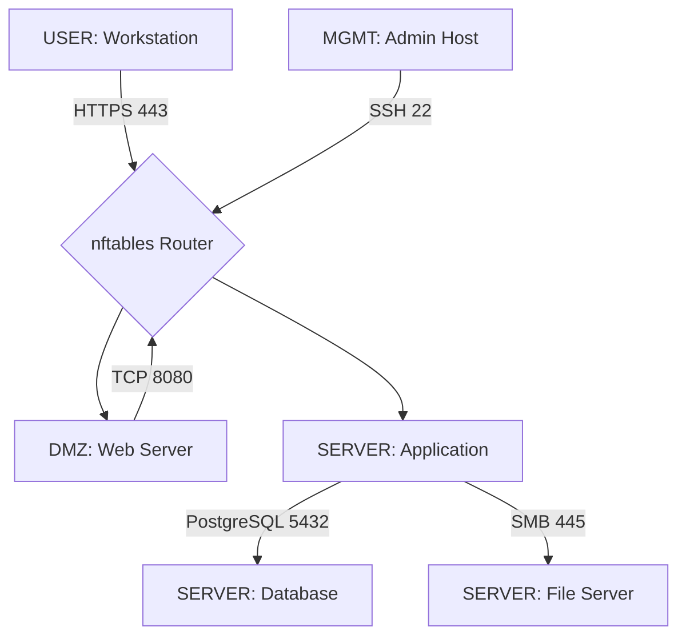

# PS2 Flatland — Network Segmentation and Firewall Design

**23CSE336 — Secure Networks | Hackathon Problem Statement 2 | Team 1**

[](https://www.docker.com/)
[](https://www.nftables.org/)
[](https://www.python.org/)
[](https://www.kernel.org/)

## Project Overview

**Flatland** is a Docker-based network security simulation demonstrating how network segmentation and a default-deny firewall can prevent lateral movement from a compromised employee workstation.

The project compares two network architectures:

- **BEFORE:** A flat network containing six interconnected hosts without segmentation.
- **AFTER:** A segmented network containing four security zones controlled by an nftables firewall.

The same five-stage attack is executed in both environments, while ten legitimate business communication flows are tested to ensure that security does not interrupt normal operations.

### Main Objective

> Prevent unauthorized lateral movement and sensitive data modification while preserving legitimate company network communication.

## Documented Results

| Security Metric | Before Segmentation | After Segmentation |
|---|---|---|
| Successful attack stages | 5/5 | 0/5 |
| Internal services exposed to workstation | 9 | 0 unauthorized services |
| Payroll database | DATA TAMPERED | DATA INTACT |
| Legitimate business flows | 10/10 PASS | 10/10 PASS |
| Network architecture | Single flat network | Four security zones |
| Firewall enforcement | No segmentation firewall | Default-deny nftables |
| Firewall evidence | Not applicable | Counters and drop logs |

These are results documented in the project report. Run the automated tests to reproduce them in your own Docker environment.

---

# 1. Problem Statement

Consider an organization operating several machines on a single internal network.

An attacker compromises an employee workstation and obtains reused credentials.

Because the network is flat, the attacker can attempt to:

1. Discover internal services.
2. Access the database server using SSH.
3. Access shared files using SMB.
4. Transfer files to another internal host.
5. Modify sensitive employee payroll information.

The proposed solution is to divide the network into security zones and enforce strict communication rules using a firewall.

The project demonstrates that unauthorized connections can be blocked while legitimate business operations continue working.

---

# 2. Technologies Used

| Technology | Purpose |
|---|---|
| Docker | Containerized company machines |
| Docker Compose | Deployment of flat and segmented networks |
| Debian Linux | Base environment for lab hosts |
| nftables | Firewall rules and packet filtering |
| Nmap | Network and port scanning |
| OpenSSH | SSH access testing |
| SCP | Remote file transfer |
| Samba | SMB file sharing |
| smbclient | File-share access testing |
| PostgreSQL 16 | Employee payroll database |
| Nginx | HTTPS web server |
| Python 3 | Employee Portal and dashboard backend |
| HTML, CSS, JavaScript | Dashboard frontend |
| Bash | Automation and testing scripts |
| tcpdump | Network packet capture |
| NFLOG / ulogd2 | Firewall logging when supported |

---

# 3. Network Architecture

## 3.1 BEFORE — Flat Network

All six containers belong to the same subnet:

`10.10.0.0/24`

| Host | Role | IP Address |
|---|---|---|
| ws | Employee workstation | 10.10.0.10 |
| web | Web server | 10.10.0.20 |
| app | Application server | 10.10.0.30 |
| db | Database server | 10.10.0.40 |
| files | File server | 10.10.0.50 |
| admin | Administrator host | 10.10.0.60 |

### Flat Network Diagram

```text
               FLAT NETWORK
               10.10.0.0/24

    +--------------------------------+
    |                                |
    | Workstation      Web Server    |
    |   .10               .20        |
    |                                |
    | Application      Database      |
    |   .30               .40        |
    |                                |
    | File Server      Admin Host    |
    |   .50               .60        |
    |                                |
    +--------------------------------+

       No segmentation firewall
```

### Security Problems

- No security-zone isolation.
- Workstation can attempt direct access to internal services.
- Reused credentials increase the risk of unauthorized access.
- Sensitive database and file services are reachable from the employee network.
- Lateral movement is easier.

---

## 3.2 AFTER — Segmented Network

The protected architecture contains four security zones.

| Zone | Subnet | Hosts |
|---|---|---|
| USER | 10.20.10.0/24 | Workstation |
| DMZ | 10.20.20.0/24 | Web server |
| SERVER | 10.20.30.0/24 | Application, Database, File server |
| MGMT | 10.20.99.0/24 | Admin host |

A seventh Docker container acts as the central firewall/router.

The router has a gateway address ending in `.254` on each zone.

### Segmented Network Diagram



### Main Security Benefits

- Employee and internal server networks are separated.
- A central router controls inter-zone traffic.
- Only required business connections are allowed.
- Unauthorized connections are dropped.
- Firewall counters and logs provide evidence of blocked traffic.

**Important:** Communication within the same SERVER subnet does not cross the central router. Optional database host-level filtering provides additional protection.

---

# 4. Firewall Design

The firewall is implemented using **nftables**.

Main configuration file:

`lab/conf/router.nft`

## 4.1 Firewall Policy

The firewall follows four principles:

1. Default deny.
2. Least privilege.
3. Stateful connection tracking.
4. Logging and monitoring.

## 4.2 Main Firewall Rules

| Rule | Source | Destination | Port | Action |
|---|---|---|---|---|
| F1 | USER | Web | TCP 443 | ACCEPT |
| F2 | Web | Application | TCP 8080 | ACCEPT |
| F3 | Admin | Managed hosts | TCP 22 | ACCEPT |
| Default | Unauthorized sources | Unauthorized destinations | Any | DROP |

### Simplified nftables Rules

```nftables
chain forward {
    type filter hook forward priority filter;
    policy drop;

    ct state established,related accept

    # F1: Workstation to Web
    ip saddr $USER_NET ip daddr $WEB tcp dport 443 accept

    # F2: Web to Application
    ip saddr $WEB ip daddr $APP tcp dport 8080 accept

    # F3: Admin SSH
    ip saddr $ADMIN ip daddr $MANAGED tcp dport 22 accept

    counter log prefix "FWD-DROP " drop
}
```

This is a simplified illustration. The full ruleset includes additional connection-state and rate-limit conditions.

## 4.3 Additional Firewall Protections

### Stateful Inspection

Allows packets belonging to established or related connections.

### Anti-Spoofing

Drops packets carrying forged source IP addresses when the supported rule is active.

### SSH Rate Limiting

Limits administrative SSH connection attempts to reduce repeated connection abuse.

### Egress Filtering

Restricts unauthorized connections initiated from protected zones.

### Router Protection

Uses a default-deny input policy to restrict access to the router itself.

### Firewall Logging

Records blocked packets through counters and supported logging facilities.

### Optional Micro-Segmentation

The file `lab/conf/db-host.nft` contains additional database host-level firewall rules.

Enable the optional feature when launching the segmented environment:

```bash
MICROSEG=1 ./run.sh seg up
```

---

# 5. Attack Simulation

Attack script:

`lab/attack.sh`

The attacker starts from the compromised workstation container.

## Five Attack Stages

| Stage | Attack | Tool |
|---|---|---|
| A1 | Internal network scanning | Nmap |
| A2 | SSH access to database host | OpenSSH |
| A3 | SMB access to file server | smbclient |
| A4 | Tool transfer to application server | SCP |
| A5 | Payroll database modification | PostgreSQL / psql |

## A1 — Network Scanning

Discovers accessible hosts and services.

MITRE ATT&CK:

- T1046 — Network Service Discovery
- T1018 — Remote System Discovery

## A2 — SSH Access

Attempts to log into the database host using deliberately reused laboratory credentials.

MITRE ATT&CK:

- T1021.004 — Remote Services: SSH

## A3 — SMB Access

Attempts to access the company file server's SMB share.

MITRE ATT&CK:

- T1021.002 — SMB/Windows Admin Shares

## A4 — File Transfer

Copies a sample tool from the compromised workstation to the application server.

MITRE ATT&CK:

- T1570 — Lateral Tool Transfer

## A5 — Database Modification

Attempts to modify an employee's payroll record.

For example:

```sql
UPDATE employees
SET salary = 999999
WHERE id = 3;
```

The demonstration compares the modified record against a known-good baseline.

MITRE ATT&CK:

- T1565.001 — Stored Data Manipulation

### Custom Attack Parameters

The final version supports choosing the employee, field and replacement value.

Example:

```bash
TARGET_ID=2 TAMPER_COL=role TAMPER_VAL=Intern ./run.sh flat attack
```

Default settings:

```text
TARGET_ID=3
TAMPER_COL=salary
TAMPER_VAL=999999
```

The attacker simulation is intended only for the isolated educational lab.

---

# 6. Legitimate Business Traffic

Business test script:

`lab/business.sh`

The project validates ten legitimate communication flows.

| Test | Source | Destination | Service |
|---|---|---|---|
| B1 | Workstation | Web | HTTPS 443 |
| B2 | Workstation | Employee Portal | Web → App → DB |
| B3 | Web | Application | TCP 8080 |
| B4 | Application | Database | PostgreSQL 5432 |
| B5 | Application | File Server | SMB 445 |
| B6 | Admin | Workstation | SSH 22 |
| B7 | Admin | Web | SSH 22 |
| B8 | Admin | Application | SSH 22 |
| B9 | Admin | Database | SSH 22 |
| B10 | Admin | File Server | SSH 22 |

### Expected Result

```text
BEFORE: 10/10 PASS
AFTER:  10/10 PASS
```

These tests verify that network segmentation does not interrupt necessary company operations.

---

# 7. Installation Requirements

## Recommended Platforms

The project runs in a Linux environment.

Supported practical setups include:

- Ubuntu Linux
- Kali Linux with Docker Engine
- Windows 10/11 using Docker Desktop and WSL2 Ubuntu

**Important:** The project shell scripts must run inside Linux or WSL2, not directly in Windows PowerShell.

## Required Software

- Docker Engine or Docker Desktop
- Docker Compose v2
- Python 3
- Git
- Bash
- Make
- zip and unzip

Docker images also require internet access during the initial build.

## Verify Dependencies

```bash
docker --version
docker compose version
python3 --version
git --version
make --version
```

Ensure Docker is running before starting the project.

---

# 8. Complete Installation Guide

## Step 1 — Clone Repository

```bash
git clone https://github.com/BharghavaIrigela/PS2-Flatland-Network-Segmentation.git
```

```bash
cd PS2-Flatland-Network-Segmentation
```

All commands below assume this directory contains `run.sh` and both Docker Compose files.

## Step 2 — Give Execution Permissions

```bash
chmod +x run.sh hack_setup_ps2.sh lab/*.sh scripts/*.sh
```

## Step 3 — Build Docker Images

```bash
docker compose -p flat -f docker-compose.flat.yml build
```

```bash
docker compose -p seg -f docker-compose.seg.yml build
```

On a supported Debian/Ubuntu environment, the bundled setup script can alternatively prepare dependencies and execute its setup tests:

```bash
./hack_setup_ps2.sh
```

Review this script before running it because it uses system package-management commands.

## Step 4 — Start Flat Network

```bash
./run.sh flat up
```

## Step 5 — Check Containers

```bash
docker ps -a
```

Or:

```bash
docker compose -p flat -f docker-compose.flat.yml ps
```

## Step 6 — Run Business Tests

```bash
./run.sh flat business
```

Expected documented result:

```text
10/10 business flows passed
```

## Step 7 — Run Attack Simulation

```bash
./run.sh flat attack
```

Expected documented result:

```text
5/5 attack stages succeeded
```

## Step 8 — Check Database Integrity

```bash
./run.sh flat integrity
```

Expected result following a successful payroll attack:

```text
DATA TAMPERED
```

## Step 9 — Stop Flat Network

```bash
./run.sh flat down
```

## Step 10 — Start Segmented Network

```bash
./run.sh seg up
```

## Step 11 — Run Business Tests

```bash
./run.sh seg business
```

Expected documented result:

```text
10/10 business flows passed
```

## Step 12 — Run Attack Simulation

```bash
./run.sh seg attack
```

Expected documented result:

```text
0/5 attack stages succeeded
```

## Step 13 — Check Database Integrity

```bash
./run.sh seg integrity
```

Expected result:

```text
DATA INTACT
```

## Step 14 — Inspect Firewall

```bash
./run.sh seg fw
```

This displays firewall rules, packet counters and available drop logs.

## Step 15 — Stop Segmented Network

```bash
./run.sh seg down
```

---

# 9. Live Dashboard

The project includes an interactive dashboard for demonstrating its security experiments.

## Dashboard Technologies

- Python 3
- Python standard-library HTTP server
- HTML
- CSS
- JavaScript
- Docker Compose integration
- subprocess-based command execution

## Start Dashboard

From the project root:

```bash
python3 dashboard/server.py
```

Open:

**http://localhost:8000**

The dashboard is bound to localhost by default.

If running inside a Kali VirtualBox VM, open the address inside the Kali browser unless additional port forwarding is configured.

## Dashboard Features

### Before/After Toggle

Switch between flat and segmented network environments.

### Network Visualization

Displays the company architecture and attack paths.

### Attack Simulation

Runs the five attack stages and displays the results.

### Payroll Monitoring

Displays employee records and detects unauthorized modifications.

### Business-Flow Testing

Displays the status of the ten legitimate communication tests.

### Firewall Monitoring

Displays nftables rule counters and available blocked-packet logs.

### Live Terminal Output

Streams execution output from the lab scripts.

## How the Dashboard Controls Docker

```text
Dashboard Frontend
        |
        v
Python Dashboard Server
        |
        v
subprocess
        |
        v
run.sh / Docker Compose
        |
        v
Docker Containers
        |
        v
Results Returned to Dashboard
```

The dashboard does not directly execute arbitrary user-provided shell commands. Its backend invokes predefined laboratory actions.

Do not expose the dashboard to public networks.

---

# 10. Employee Portal

The project includes an employee web application backed by PostgreSQL.

Start either lab, then open:

**https://localhost:8443**

The application uses a self-signed TLS certificate, so a certificate warning may appear in your local lab browser.

### Application Request Path

```text
Workstation
    |
    | HTTPS 443
    v
Nginx Web Server
    |
    | TCP 8080
    v
Python Application
    |
    | PostgreSQL 5432
    v
Employee Database
```

This business path must continue working after segmentation.

---

# 11. Automated Testing

## Static Validation

```bash
make test
```

Static checks include required files, script validity, Python syntax and Docker Compose configuration.

### Network Diagram Requirement

The source ZIP contains:

```text
docs/diagrams/network-after.mmd
```

For the static test, export this diagram to a nonempty image file such as:

```text
docs/diagrams/network-after.svg
```

You can use:

https://mermaid.live/

Paste the Mermaid source, export the diagram as SVG and save it in `docs/diagrams/`.

Alternatively, with Mermaid CLI installed:

```bash
mmdc -i docs/diagrams/network-after.mmd -o docs/diagrams/network-after.svg
```

## Complete Smoke Test

```bash
make smoke
```

This executes automated checks across the flat and segmented environments.

It verifies the expected attack, business-flow and database-integrity outcomes.

## Package Project

```bash
make zip
```

## Validate Clean ZIP

```bash
make test-fresh
```

To also run the full smoke test after fresh extraction:

```bash
FULL=1 make test-fresh
```

---

# 12. Docker Monitoring Commands

## List Containers

```bash
docker ps -a
```

## Check Segmented Containers

```bash
docker compose -p seg -f docker-compose.seg.yml ps
```

## View Container Logs

```bash
docker compose -p seg -f docker-compose.seg.yml logs -f --tail=50
```

Press `Ctrl+C` to stop following logs.

## Monitor Resource Usage

```bash
docker stats
```

## List Docker Networks

```bash
docker network ls
```

## Check Router Interfaces

```bash
docker compose -p seg -f docker-compose.seg.yml exec router ip -br addr
```

## Check Workstation Routes

```bash
docker compose -p seg -f docker-compose.seg.yml exec ws ip route
```

---

# 13. nftables Monitoring

## View Firewall Rules

```bash
docker compose -p seg -f docker-compose.seg.yml exec router nft list ruleset
```

## View Firewall Table and Counters

```bash
docker compose -p seg -f docker-compose.seg.yml exec router nft list table inet lab
```

## View Firewall Evidence

```bash
./run.sh seg fw
```

## Live Firewall Monitoring

```bash
watch -n 1 'docker compose -p seg -f docker-compose.seg.yml exec -T router nft list table inet lab'
```

Run attacks from another terminal to observe counters increasing.

Firewall logging depends on available Linux kernel support. Packet counters can still provide evidence if NFLOG is unavailable.

---

# 14. Evidence Collection

The project stores generated results in:

```text
evidence/
```

Evidence may include:

```text
evidence/
├── attack_flat_<timestamp>.txt
├── attack_flat_<timestamp>.pcap
├── attack_seg_<timestamp>.txt
├── attack_seg_<timestamp>.pcap
├── business_flat_<timestamp>.txt
├── business_seg_<timestamp>.txt
├── integrity_<mode>_<timestamp>.txt
├── ruleset_counters_<timestamp>.txt
├── fw_drops_<timestamp>.txt
└── smoke/
```

Evidence categories:

- Attack execution results
- Legitimate business-flow results
- Database integrity checks
- Firewall rule counters
- Blocked-packet logs
- Packet captures

The project report documents a captured run in which the final firewall drop rule counted 93 packets and 40 blocked-packet log entries were collected.

Actual counts will vary between runs.

---

# 15. Project Structure

```text
PS2-Flatland-Network-Segmentation/
│
├── README.md
├── Makefile
├── run.sh
├── hack_setup_ps2.sh
│
├── docker-compose.flat.yml
├── docker-compose.seg.yml
│
├── image/
│   └── Dockerfile
│
├── db-image/
│   └── Dockerfile
│
├── lab/
│   ├── attack.sh
│   ├── business.sh
│   ├── integrity.sh
│   ├── app.py
│   ├── entry.sh
│   ├── db-entry.sh
│   │
│   └── conf/
│       ├── router.nft
│       ├── db-host.nft
│       ├── init.sql
│       ├── employees.baseline
│       ├── nginx-web.conf
│       └── smb.conf
│
├── dashboard/
│   ├── server.py
│   └── index.html
│
├── scripts/
│   ├── check_static.sh
│   └── smoke.sh
│
├── docs/
│   ├── report.md
│   ├── demo-script.md
│   ├── flow-matrix.md
│   ├── attack-mapping.md
│   └── diagrams/
│       └── network-after.mmd
│
├── evidence/
│
└── submission/
    ├── Team1_PPT.pptx
    ├── Team1_Report_PDF.pdf
    ├── Team1_Report_Word.docx
    └── Team1_README.md
```

The submission directory contains the final presentation and reports when these files are included in the repository.

---

# 16. Troubleshooting

## Docker Daemon Not Running

Check:

```bash
docker ps
```

Start Docker Desktop or the Linux Docker service if necessary.

## Docker Permission Denied

Ensure the current Linux user can access the Docker daemon.

## Permission Denied on Scripts

```bash
chmod +x run.sh lab/*.sh scripts/*.sh
```

## Employee Portal Not Opening

Check containers:

```bash
docker ps
```

Verify the web server from inside the lab:

```bash
docker compose -p seg -f docker-compose.seg.yml exec ws curl -sk https://web/
```

## Dashboard Not Opening

Ensure:

```bash
python3 dashboard/server.py
```

is running.

Then open:

```text
http://localhost:8000
```

## Firewall Logs Missing

Some systems do not support NFLOG inside Docker network namespaces.

Check the active firewall counters:

```bash
./run.sh seg fw
```

## Database Already Modified

Reset the selected lab:

```bash
./run.sh flat reset
```

or:

```bash
./run.sh seg reset
```

Warning: Resetting recreates the lab and removes its existing database volumes.

## Firewall Changes Not Applied

Restart the router:

```bash
docker compose -p seg -f docker-compose.seg.yml restart router
```

Then inspect its startup logs.

## Docker Network Address Conflicts

Ensure the configured subnets do not conflict with existing Docker networks.

If addresses are changed, update Docker Compose and firewall configurations consistently.

---

# 17. Security Limitations

This is an educational demonstration, not a production-ready enterprise network.

Known limitations include:

1. The attacker is assumed to have already compromised an employee workstation.
2. Deliberately weak laboratory credentials are used.
3. Communication inside the SERVER subnet is not filtered by the central router.
4. Permitted web and application connections remain potential attack paths.
5. Firewall logging and anti-spoofing availability may depend on kernel support.
6. The router represents a single point of failure.
7. Container networking capabilities are configured for laboratory simulation.

Potential future enhancements:

- Separate APP, DATABASE and FILE zones
- Host-based firewalls for sensitive services
- Multi-factor authentication
- Key-based SSH
- Centralized security monitoring
- Intrusion detection
- Secret management
- Redundant firewall gateways

---

# 18. Hackathon Requirement Coverage

| Requirement | Implementation |
|---|---|
| Flat network containing six hosts | Docker Compose flat environment |
| Network attack simulation | Five-stage attack script |
| Business traffic validation | Ten communication checks |
| Network segmentation | Four security zones |
| Firewall enforcement | nftables default-deny router |
| Lateral movement prevention | Blocked cross-zone connections |
| Data integrity validation | Payroll baseline comparison |
| Packet evidence | tcpdump PCAP captures |
| Firewall monitoring | Counters and available drop logs |
| Before/after comparison | Automated scripts and dashboard |
| Documentation | Reports, diagrams and evidence |

---

# 19. Final Submission Checklist

Before submitting the project, verify:

- [ ] Source code is located at the repository root.
- [ ] Both Docker Compose configurations are included.
- [ ] Firewall configuration is included.
- [ ] All attack scripts are included.
- [ ] All ten business-flow checks are available.
- [ ] Dashboard files are included.
- [ ] Network diagram is exported.
- [ ] `make test` passes.
- [ ] `make smoke` passes.
- [ ] Flat-network attacks produce the expected results.
- [ ] Segmented-network attacks are blocked.
- [ ] Database integrity checks produce the expected results.
- [ ] Firewall evidence is collected.
- [ ] PowerPoint and reports are included.
- [ ] No real credentials or private keys are committed.
- [ ] All final changes are pushed to GitHub.

---

# 20. Team Members

| Name | Registration Number |
|---|---|
| Irigela Bharghava Vardhan Reddy | BL.EN.U4CSE23016 |
| Sahith Yeluguri | BL.EN.U4CSE23066 |
| Pranav Achudha S | BL.EN.U4CSE23042 |
| S Jishwanth Sai Satwik | BL.EN.U4CSE23049 |
| Kishore Kumar S | BL.EN.U4CSE23232 |

**Course:** 23CSE336 — Secure Networks

**Problem Statement:** PS-2 Flatland — Network Segmentation and Firewall Design

**Repository:** https://github.com/BharghavaIrigela/PS2-Flatland-Network-Segmentation

---

## Conclusion

This project demonstrates the effectiveness of network segmentation and default-deny firewall policies in limiting lateral movement within an organizational network.

By comparing a flat network with a segmented network, we demonstrate how unauthorized access to internal services can be restricted without interrupting legitimate communication.

The documented results show five successful attack stages before segmentation and zero afterward, while all ten business flows continue working.

**Key takeaway: Secure the network without breaking the business.**

---

**Disclaimer:** This project is intended exclusively for educational use in an isolated laboratory environment.