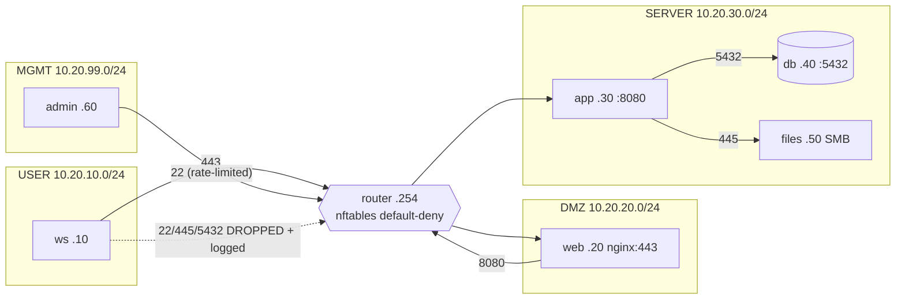

# PS-2 Flatland: network segmentation and firewall design

**Course:** 23CSE336 Secure Networks  ·  **Team 1**

| Roll number | Name |
|---|---|
| BL.EN.U4CSE23066 | Sahith Yeluguri |
| BL.EN.U4CSE23042 | Pranav Achudha S |
| BL.EN.U4CSE23049 | S Jishwanth Sai Satwik |
| BL.EN.U4CSE23232 | Kishore Kumar S |
| BL.EN.U4CSE23016 | Irigela Bhargava Vardhan Reddy |

---

## 1. Summary

A company runs six hosts on one flat network. One employee workstation (`ws`) is compromised. We show how far the attacker gets, then rebuild the network into four zones behind a default-deny router so the same attack fails while the business keeps working.

| Measure | BEFORE (flat) | AFTER (segmented) |
|---|---|---|
| Attack stages succeeded | **5 / 5** | **0 / 5** |
| Internal services visible from ws | 9 | 0 (only web:443, by design) |
| Payroll data | **DATA TAMPERED** (id 3: 72000 → 999999) | **DATA INTACT** |
| Business flows passing | 10 / 10 | 10 / 10 |
| Firewall evidence | none | counters + FWD-DROP logs (93 drops in the captured run) |

Proof files are in `evidence/` (attack, business, integrity, ruleset counters, drop logs, micro-segmentation tests, packet captures).

---

## 2. Problem and threat model

- **Hosts:** `ws` (employee PC), `web` (nginx, HTTPS 443), `app` (Employee Portal, 8080), `db` (PostgreSQL 16, payroll table), `files` (Samba 445), `admin` (jump host).
- **Flat design:** one /24, no filtering. Any host reaches any port on any other host.
- **Attacker starts with:** a shell on `ws`, a reused SSH password, and the portal's database password found on disk.
- **Goal:** reach payroll data and change a record.
- **Out of scope:** exploiting server software, attacking the router.

---

## 3. Method and evidence

| Script | Runs where | What it does |
|---|---|---|
| `lab/attack.sh` | inside `ws` | Five stages A1–A5. Prints SUCCEEDED or BLOCKED. A pcap is saved. |
| `lab/business.sh` | host | 10 business flows, each run from its real source container. Prints PASS or FAIL. |
| `lab/integrity.sh` | host | Reads `employees` from inside the db container (trusted path) and diffs it with `lab/conf/employees.baseline`. |

### Attack chain and ATT&CK mapping

| Stage | What the attacker does | ATT&CK | Before | After | D3FEND / mitigation |
|---|---|---|---|---|---|
| A1 | Scan internal hosts | T1046, T1018 | succeeds | only web:443 visible | Network Isolation, M1030 |
| A2 | SSH ws → db | T1021.004 | succeeds | blocked | Inbound Traffic Filtering, M1037 |
| A3 | SMB ws → files | T1021.002 | succeeds | blocked | Inbound Traffic Filtering, M1037 |
| A4 | Copy a tool ws → app | T1570 | succeeds | blocked | Network Isolation, M1030 |
| A5 | Change a salary in db | T1565.001 | succeeds → TAMPERED | blocked → INTACT | M1030, M1037, micro-segmentation |

Full tables: `docs/attack-mapping.md` and `.csv`.

---

## 4. Design

### 4.1 Zones and addressing

| Zone | Subnet | Hosts | Trust |
|---|---|---|---|
| USER | 10.20.10.0/24 | ws .10 | low, assume compromised |
| DMZ | 10.20.20.0/24 | web .20 | public-facing |
| SERVER | 10.20.30.0/24 | app .30, db .40, files .50 | high |
| MGMT | 10.20.99.0/24 | admin .60 | privileged |
| all | .254 in each | router | enforcement point |

Flat (before): all six hosts on 10.10.0.0/24, `.10` to `.60`.

Each zone is a separate Docker network. The `router` container is attached to all four with `ip_forward=1`. Every host sets its default route to the router, so all cross-zone traffic crosses it. The networks are not `internal: true`, because Docker then drops routed traffic.

### 4.2 Flow matrix (written before any rule)

| # | Source | Destination | Port | Why | Router rule |
|---|---|---|---|---|---|
| B1 | USER (ws) | web | 443/tcp | Browse the company site | F1 |
| B2 | ws → web → app → db | chain | 443 → 8080 → 5432 | Employee Portal | F1 + F2 |
| B3 | web | app | 8080/tcp | Reverse proxy | F2 |
| B4 | app | db | 5432/tcp | Portal queries payroll | same zone (db host firewall with `MICROSEG=1`) |
| B5 | app | files | 445/tcp | Portal writes reports | same zone, not filtered |
| B6 | admin | all hosts | 22/tcp | Administration | F3, rate-limited |
| – | anything else | anything | any | not needed | **DROP + log** |

### 4.3 Router ruleset (`lab/conf/router.nft`, table `inet lab`)

- **forward:** policy **drop**. `established,related` accepted (stateful replies). `invalid` dropped.
- **F1:** USER → web:443, new connections only.
- **F2:** web → app:8080, new connections only.
- **F3:** admin → managed hosts:22. Above 10 new connections per minute: logged (`SSH-RATELIMIT`) and dropped. Admin ICMP echo allowed.
- **Final rule:** `counter log prefix "FWD-DROP " drop`. This also gives egress filtering: servers cannot start outbound connections.
- **input:** policy drop (only admin ping). Nobody can connect to the router.
- **prerouting:** reverse-path check `fib saddr . iif oif missing drop` (`SPOOF-DROP`). The workstation cannot forge admin's address.
- **Logging:** NFLOG to `ulogd2`, because kernel `log` is off inside container namespaces. `entry.sh` falls back (no logging, then no anti-spoofing) and prints an explicit ERROR if nothing loads, so the router never fails silently.

### 4.4 Why these choices

| Choice | Reason |
|---|---|
| Default deny | Anything forgotten stays closed. Default allow leaves it open. |
| Rules from the flow matrix | Every open path has a business reason. Least privilege. |
| DROP, not REJECT | The attacker only sees timeouts and learns nothing. |
| One router | One choke point, one rule file to audit. |
| Jump host with rate limit | One controlled entry for administration. Slows password guessing. |
| Integrity read inside db | The check cannot be fooled by the network or the firewall. |

### 4.5 Network diagram

Image: `docs/diagrams/network-after.png` (and `.svg`). Source: `docs/diagrams/network-after.mmd`.



---

## 5. Results

### Flat network
- 9 internal services visible from `ws`: SSH on five hosts, 8080, 5432, 139, 445.
- 5 of 5 stages succeeded. Integrity: `3|Meera Iyer|HR|HR Manager|72000` became `…|999999`.
- Business: 10 / 10.

### Segmented network
- 0 of 5 stages. The attacker sees timeouts, not refusals.
- Integrity: DATA INTACT. Business: 10 / 10.
- **Firewall proof** (`evidence/ruleset_counters_054238.txt`, `fw_drops_054238.txt`): 93 packets hit the default-deny rule, 40 drops logged, all from `ws` toward db, files, app and web on ports 5432, 22, 445, 139, 8080 and 80. Allow rules matched 10 new connections (F1: 3, F2: 2, F3: 5).
- **Micro-segmentation** (`evidence/microseg_*.txt`): app → db works, files → db times out.

---

## 6. Known weaknesses and next steps

1. **Same-zone traffic is not filtered.** `app`, `db` and `files` share one subnet, so the router never sees their traffic. `db` is covered by its own host firewall (`MICROSEG=1`). Fix: split SERVER into APP, DATA and FILE zones, or add a host firewall on `files`.
2. **Allowed paths are still paths.** F1 and F2 permit the chain an attacker needs if `web` is exploited. This needs application-layer controls (WAF, patching, a least-privilege DB role).
3. **Credentials are the real enabler.** Reused passwords and a DB password on a workstation. Fix: key-only SSH through the jump host, unique secrets in a vault. Segmentation removes the network path, not the stolen password (defence in depth).
4. **Lab artefacts.** Containers hold `NET_ADMIN` to set routes. The router is a single container. Production would use a redundant pair and ship logs to a SIEM.
5. **The SSH rate-limit rule is loaded but its counter is 0** in the captured run, because the test never exceeded 10 new connections per minute.

---

## 7. How to run

```bash
cd ~/flatland && chmod +x run.sh lab/*.sh scripts/*.sh   # once
./hack_setup_ps2.sh                                      # once: pre-build images + smoke test (internet needed)
make test                                                # static checks
python3 dashboard/server.py                              # then open http://localhost:8000
make smoke                                               # full before/after run with assertions (~5 min)
make zip && make test-fresh                              # build and verify the submission zip
```

Attacker-chosen target (stage A5). The attacker picks which row, field and value to change:

```bash
TARGET_ID=2 TAMPER_COL=role TAMPER_VAL=Intern ./run.sh flat attack
```
Defaults: id 3, column `salary`, value `999999`. The dashboard has the same picker (row, field, value) above the attack chain. In the segmented lab the same command is blocked and the row stays intact.

Manual control:

```bash
./run.sh flat up && ./run.sh flat business && ./run.sh flat attack && ./run.sh flat down
./run.sh seg  up && ./run.sh seg  business && ./run.sh seg  attack && ./run.sh seg fw && ./run.sh seg down
```

Employee Portal: **https://localhost:8443** (accept the self-signed certificate). `./run.sh <mode> reset` restores clean data. Every run is saved with a timestamp in `evidence/`.

Dashboard: toggle BEFORE or AFTER, press **Start lab**, then **Run full demo**. It listens on 127.0.0.1 only and can run only `./run.sh` commands.

Lab credentials (on purpose, to model reuse): SSH user `it` / `Summer2024` on every host; DB `appuser` / `AppDb2024`.

---

## 8. Files

| Path | Purpose |
|---|---|
| `docs/` | Report, demo script, speaker notes, flow matrix, ATT&CK mapping, diagrams, study guide |
| `docker-compose.flat.yml` | BEFORE: 6 hosts on 10.10.0.0/24 |
| `docker-compose.seg.yml` | AFTER: 4 zones plus the router |
| `lab/conf/router.nft` | Router ruleset (main deliverable) |
| `lab/conf/db-host.nft` | Stretch: micro-segmentation on db |
| `lab/attack.sh`, `lab/business.sh`, `lab/integrity.sh` | Attack, business and integrity scripts |
| `lab/app.py`, `lab/conf/init.sql` | Employee Portal and seed data |
| `lab/entry.sh`, `lab/db-entry.sh` | Container start-up and ruleset loading |
| `run.sh`, `Makefile`, `scripts/` | Control, tests, packaging |
| `dashboard/` | Live web dashboard |
| `evidence/` | Run outputs, pcaps, firewall counters and logs |

---

## 9. Demo (about 7 minutes)

Full script with roles and likely judge questions: `docs/demo-script.md`.
Judges may run their own command, for example:
`docker compose -p seg -f docker-compose.seg.yml exec ws nmap -Pn -p- db`

## 10. Troubleshooting

- Portal does not open in seg mode: `docker compose -p seg -f docker-compose.seg.yml exec ws curl -sk https://web/`
- Seed data loads only on a fresh db: use `./run.sh <mode> reset`.
- Subnet clash on `up`: change the 10.10 / 10.20 ranges in the compose files and `router.nft` together.
- `WARN: … retrying without NFLOG`: the kernel lacks NFLOG. Drops are still enforced; show the counters.
- Do not set `internal: true` on the seg networks.
- After editing `router.nft`: `docker compose -p seg -f docker-compose.seg.yml restart router`.
